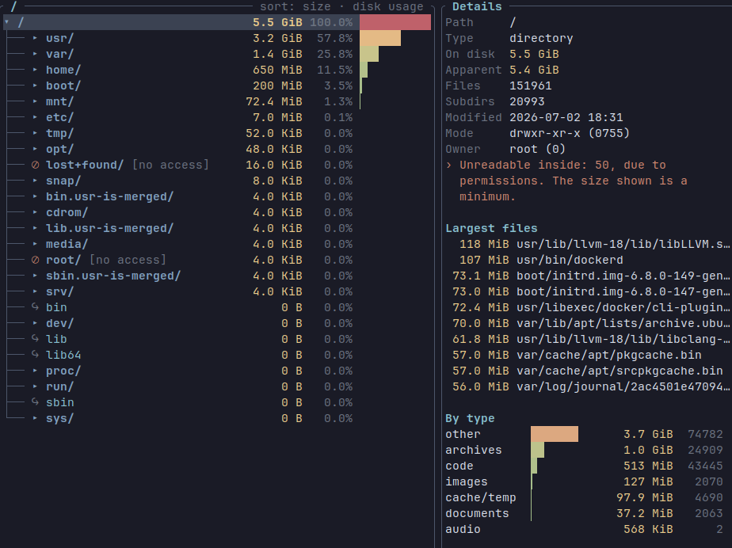

# ramas

Analizador de uso de disco en árbol, interactivo, para la terminal de Linux:
una alternativa visual a `ncdu`. Escanea un directorio en paralelo y lo
muestra como un árbol expandible con barras proporcionales, panel de detalle,
borrado en lote seguro, búsqueda difusa, filtros, análisis por tipo, temas y
exportación/diff en JSON.

[Read in English](README.md)



## Funciones

- **Escaneo paralelo rápido** (rayon + `std::fs`) con pantalla de progreso
  cancelable. Uso en disco (bloques) por defecto y tamaño aparente con `a`.
  Hard links contados una vez, symlinks nunca seguidos, `-x` no cruza sistemas
  de archivos, se saltan `/proc`, `/sys`, `/dev` y otros pseudo sistemas de
  archivos. Los errores de permisos se marcan en el nodo y se cuentan, sin abortar.
- **Árbol compacto en arena**: unos 85 MiB por millón de entradas; la UI solo
  dibuja la ventana visible y se mantiene fluida con árboles enormes.
- **Árbol + panel lateral**: conectores, iconos, tamaño, porcentaje del padre y
  barra con gradiente por fila; el panel muestra ruta, tamaños, conteos, fecha,
  permisos, los 10 archivos más pesados y el desglose por tipo.
- **Borrado en lote con resguardos**: marcá con `Espacio`, revisá en un diálogo
  que arranca en *Cancelar*, mandá a la papelera o borrá en forma permanente
  escribiendo una palabra de confirmación. El árbol se actualiza sin reescanear.
- **Búsqueda y filtros**: búsqueda difusa `/` que expande las ramas con
  coincidencias; filtros combinables por tamaño mínimo, extensión y antigüedad,
  atenuando u ocultando.
- **Análisis por tipo** (`t`): video, imágenes, audio, documentos, comprimidos,
  código, caché/temporales y otros, configurable; abrí una categoría para
  listar y marcar sus archivos más pesados.
- **Temas e iconos**: 31 temas (Catppuccin, Gruvbox, Nord, Dracula, claros,
  retro, alto contraste, seguros para daltonismo…) que se eligen con `T` con
  vista previa en vivo, más los tuyos; iconos Nerd Font, Unicode o ASCII puro;
  respeta `NO_COLOR`.
- **Interfaz en inglés y español** (`--lang es`).
- **Exportar / importar / diff**: guardá un escaneo en JSON, abrilo después o
  comparalo con uno nuevo para ver qué creció, se achicó o es nuevo.
- **Binario estático**: sin dependencias de C, compila para
  `x86_64-unknown-linux-musl`.

## Instalación

Requiere Linux x86-64. Con cualquiera de estas opciones, se abre escribiendo `ramas`.

### Paquete (Debian, Ubuntu, Fedora, openSUSE…)

Bajá el paquete de tu distribución desde el
[último release](https://github.com/workharleyhsu/ramas/releases/latest) y abrilo con tu centro de software,
o instalalo desde una terminal:

```sh
sudo apt install ./ramas_0.1.1-1_amd64.deb      # Debian, Ubuntu, Mint…
sudo dnf install ./ramas-0.1.1-1.x86_64.rpm     # Fedora, RHEL…
sudo zypper install ./ramas-0.1.1-1.x86_64.rpm  # openSUSE
```

Se desinstala con `sudo apt remove ramas` o `sudo dnf remove ramas`.

### Instalador de una línea (cualquier distribución)

```sh
curl -fsSL https://raw.githubusercontent.com/workharleyhsu/ramas/main/install.sh | sh
```

Baja el último release, verifica su suma SHA-256 e instala el binario en
`~/.local/bin` y la página man en `~/.local/share/man/man1`. No necesita root.
Si esa carpeta no está en tu `PATH`, el script te dice qué línea agregar. Se
desinstala con `rm ~/.local/bin/ramas`.

### Manual

Todas las opciones usan el mismo ejecutable estático, así que no depende de la
versión de tu distribución. También podés descomprimirlo vos:

```sh
tar -xzf ramas-0.1.1-x86_64-linux.tar.gz
sha256sum -c ramas-0.1.1-x86_64-linux.tar.gz.sha256   # opcional
install -Dm755 ramas-0.1.1-x86_64-linux/ramas ~/.local/bin/ramas
```

### Desde el código

```sh
git clone https://github.com/workharleyhsu/ramas && cd ramas
cargo install --path .
```

`scripts/package.sh` arma en `dist/` el binario estático, el tarball, el `.deb`
y el `.rpm` (`--containers` además lo ejecuta en Alpine y Debian).

## Uso

```sh
ramas                         # escanea el directorio actual
ramas -x /                    # el sistema de archivos raíz, sin cruzar montajes
ramas --read-only ~/Descargas # navegar con el borrado deshabilitado
ramas --export home.json ~    # escanear sin TUI y guardar el resultado
ramas --import home.json      # abrir un escaneo guardado (sin borrado)
ramas --diff home.json ~      # resaltar qué creció, se achicó o es nuevo
```

`ramas --help` lista todas las opciones, teclas y ajustes; `man ramas` tiene lo mismo.

## Teclas

| Tecla | Acción |
|---|---|
| `↑ ↓ / k j` | Mover |
| `→ / l` | Expandir / entrar |
| `← / h` | Colapsar / ir al padre |
| `Enter` | Alternar expansión |
| `RePág AvPág Inicio Fin` | Página arriba/abajo, primero, último |
| `Espacio` | Marcar / desmarcar (baja una fila) |
| `u` | Quitar todas las marcas |
| `d` | Borrar lo marcado (diálogo) |
| `r` | Reescanear el directorio seleccionado |
| `/` | Búsqueda difusa incremental |
| `n / N` | Coincidencia siguiente / anterior |
| `f` | Filtros: tamaño mínimo, extensiones, antigüedad; atenuar u ocultar |
| `t` | Análisis por tipo del nodo seleccionado |
| `s` | Ciclar orden: tamaño, nombre, fecha, ítems |
| `a` | Alternar tamaño aparente / en disco |
| `p` | Mostrar / ocultar el panel lateral |
| `T` | Elegir tema (vista previa en vivo) |
| `e` | Exportar JSON al directorio actual |
| `?` | Ayuda |
| `q` | Salir |

Mouse: clic selecciona, doble clic expande o colapsa, la rueda desplaza.

## Borrado seguro

```text
╭ /home/ana ─────────────────────── orden: tamaño · uso en disco ╮╭ Detalle ─────────────────────────────────╮
│▾ /home/ana                            5.8 GiB 100.0% ██████████││Ruta       /home/ana/code                 │
│├── ▾ Videos/                          4.1 GiB  70.7% ███████▏  ││Tipo       directorio                     │
││   ├── ✔ trip-2025.mkv                3.3 GiB  80.6% ████████  ││En disco   150 MiB                        │
││   └── · talk.mp4                     820 MiB  19.4% ██        ││Aparente   150 MiB                        │
│├── ╭ Borrar elementos marcados ───────────────────────────────────────────────────────────────────────╮    │
│├── │   3.3 GiB  /home/ana/Videos/trip-2025.mkv                                                        │    │
│├── │   410 MiB  /home/ana/Music                                                                       │    │
│├── │                                                                                                  │    │
│└── │ Total a liberar: 3.7 GiB                                                                         │    │
│    │                                                                                                  │    │
│    │ [ Papelera ]  [ Borrar permanente ]  [ Cancelar ]                                                │    │
│    │                                                                                                  │    │
│    ╰──────────────────────────────────────────────────────────────────────────────────────────────────╯    │
│                                                                ││Por tipo                                  │
╰────────────────────────────────────────────────────────────────╯╰──────────────────────────────────────────╯
 Total 5.8 GiB · 2 elementos marcados — 3.7 GiB a liberar
 ←→/Tab elegir  Enter confirmar  Esc cancelar
```

Cada ruta marcada se verifica justo antes de borrarla:

- se reconstruye desde su **padre** canonicalizado más su propio nombre, así un
  symlink se evalúa como sí mismo y nunca como su destino;
- tiene que estar estrictamente dentro de la raíz escaneada;
- se rechazan `/`, `$HOME` (y cualquier directorio que lo contenga) y la raíz
  del escaneo;
- tiene que seguir existiendo con el mismo dispositivo e inodo que se escanearon.

Los symlinks se borran, nunca se siguen. Marcar un directorio cubre todo su
contenido, así que nunca quedan marcados a la vez un padre y su hijo.
`--read-only` deshabilita el borrado por completo, igual que un escaneo
importado hasta que reescanees su raíz con `r`.

## Carpetas marcadas `[sin acceso]`

Sin root hay carpetas que no se pueden leer: por ejemplo datos del sistema o
de contenedores que son de otro usuario. `ramas` las marca con `⊘` y
`[sin acceso]`, las cuenta como *Sin acceso* en la barra de estado y lo
explica en el panel: no hay nada dañado, solo que su contenido no se cuenta,
así que los tamaños de las carpetas de arriba son un mínimo. Para incluirlas,
escaneá como su dueño, por ejemplo `sudo ramas --read-only RUTA`.

## Análisis por tipo

```text
╭ /home/ana ─────────────────────── orden: tamaño · uso en disco ╮╭ Detalle ─────────────────────────────────╮
│▾╭ Tipos en /home/ana ────────────────────────────────────────────────────────────────────────────────────╮ │
│├│ Categoría           Tamaño Cantidad                                                                    │ │
│├│ video              4.1 GiB        2  ████████████████████████████▎             70.7%                   │ │
│├│ caché/temp         1.1 GiB        2  ███████▋                                  19.1%                   │ │
│├│ audio              410 MiB        1  ██▊                                        6.9%                   │ │
│├│ comprimidos        150 MiB        1  █                                          2.5%                   │ │
│└│ imágenes          45.0 MiB        3  ▎                                          0.8%                   │ │
│ │ código             128 KiB        1                                             0.0%                   │ │
│ │ documentos        20.5 KiB        1                                             0.0%                   │ │
│ │                                                                                                        │ │
╰─╰────────────────────────────────────────────────────────────────────────────────────────────────────────╯─╯
 Total 5.8 GiB · 0 elementos marcados — 0 B a liberar
 Enter: archivos más pesados  Esc: volver
```

## Configuración

`~/.config/ramas/config.toml` (o `--config ARCHIVO`); todas las claves son
opcionales. Las opciones de línea de comandos tienen prioridad.

```toml
language = "es"            # en | es
icons = "nerd"             # nerd | unicode | ascii
theme = "gruvbox-dark"     # el id de cualquier tema; `T` elige uno y lo guarda acá

[categories]               # una clave existente reemplaza su lista, una nueva agrega categoría
video = ["mp4", "mkv", "webm"]
models = ["gguf", "safetensors"]

[custom_theme]             # se usa con theme = "custom"
base = "dark"              # los colores no indicados salen de este tema
accent = "#ff8800"
selected_bg = "blue"
```

Claves del tema personalizado: `fg bg dim accent border connector dir
selected_fg selected_bg size marked error warn bar_low bar_mid bar_high
status_fg status_bg grew shrank new matched`.

## Temas

`T` abre el selector de temas: las flechas muestran cada tema en toda la
pantalla, escribir filtra la lista, `Enter` deja el tema y lo guarda en la
configuración, y `Esc` vuelve al que tenías. `--theme ID` elige uno para una
sola ejecución.

Hay 31 temas en cinco familias: los de fábrica (`ramas`, `ramas-light`),
populares (Catppuccin, Dracula, Everforest, Gruvbox, Kanagawa, Monokai, Nord,
One Dark, Rosé Pine, Solarized, Tokyo Night), claros y pastel, retro y neón
(fósforo verde, ámbar, gris, cyberpunk, synthwave) y accesibles (alto
contraste, y paletas Okabe-Ito para daltonismo). Los nombres de ramas 0.1
(`dark`, `light`, `high-contrast`, `gruvbox`) siguen funcionando.

Para crear el tuyo, dejá un archivo TOML en `~/.config/ramas/themes/`: partí
de [`docs/example-theme.toml`](docs/example-theme.toml) y mirá
[la guía de temas](docs/THEMES.es.md). Un archivo de tema roto solo muestra
un aviso.

Los colores se adaptan a la terminal: 24 bits, 256 colores, 16 colores, o
ninguno con `NO_COLOR`.

## Formato de exportación

Un objeto JSON con un encabezado y una lista plana de nodos en orden de
profundidad, cada uno con el índice de su padre, así cualquier profundidad
hace round-trip. Los tamaños son por nodo; los totales de directorio se
recalculan al importar. Exportar un escaneo importado da un archivo idéntico
byte a byte.

## Desarrollo

```sh
scripts/ci.sh                                   # fmt --check, clippy -D warnings, tests
cargo run --release --example bench_scan -- /usr
cargo run --release --example bench_ui          # árbol sintético de 1M entradas
cargo run --example screenshots -- es           # las capturas de este README
```

Los tests de borrado solo tocan directorios temporales; el de papelera corre
en un proceso hijo con un `XDG_DATA_HOME` aislado.

## Licencia

MIT OR Apache-2.0.
