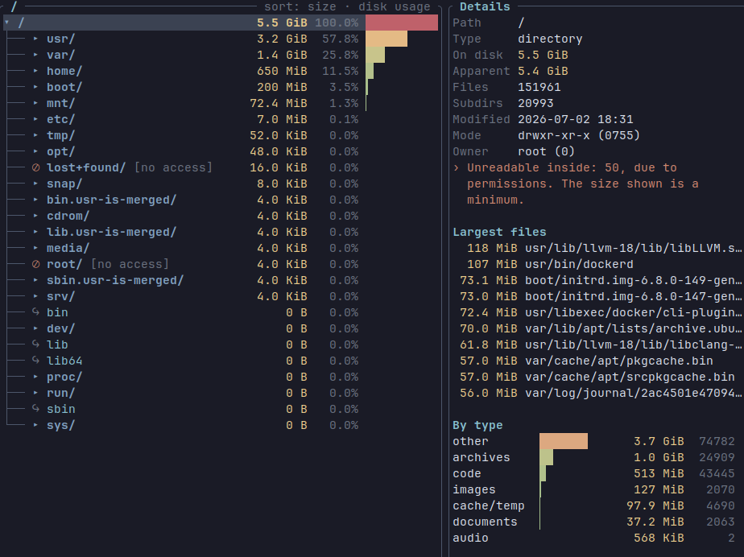

# ramas

Interactive, tree-style disk usage analyzer for the Linux terminal — a visual
alternative to `ncdu`. It scans a directory in parallel and shows it as an
expandable tree with proportional bars, a detail panel, safe batch deletion,
fuzzy search, filters, per-type analysis, themes and JSON export/diff.

[Leer en español](README.es.md)



## Features

- **Fast parallel scan** (rayon + `std::fs`) with a cancellable progress screen.
  Disk usage (blocks) by default, apparent size with `a`. Hard links counted
  once, symlinks never followed, `-x` stays on one filesystem, `/proc`, `/sys`,
  `/dev` and other pseudo filesystems are skipped. Permission errors are
  marked on the node and counted, never fatal.
- **Compact arena tree**: about 85 MiB for a million entries; the UI only
  renders the visible window, so it stays fluid on huge trees.
- **Tree + side panel**: connectors, icons, size, share of the parent and a
  color-graded bar per row; the panel shows path, sizes, counts, mtime,
  permissions, the 10 largest files and a breakdown by type.
- **Batch deletion with guard rails**: mark with `Space`, review in a dialog
  that starts on *Cancel*, move to the trash or delete permanently after
  typing a confirmation word. The tree updates without a rescan.
- **Search and filters**: fuzzy `/` search that expands matching branches;
  combinable filters by minimum size, extension and age, dimming or hiding.
- **Type analysis** (`t`): video, images, audio, documents, archives, code,
  cache/temp and others, configurable; open a category to list and mark its
  largest files.
- **Themes and icons**: 32 themes (Catppuccin, Gruvbox, Nord, Dracula, light,
  retro, high-contrast, color-blind safe…) picked with `T` and a live preview,
  plus your own; Nerd Font, Unicode or pure ASCII icons; honors `NO_COLOR`.
- **English and Spanish UI** (`--lang es`).
- **Export / import / diff**: save a scan as JSON, browse it later, or compare
  a new scan against it to see what grew, shrank or is new.
- **Static binary**: no C dependencies, builds for `x86_64-unknown-linux-musl`.

## Install

Requires x86-64 Linux. After any of these, run it by typing `ramas`.

### Package (Debian, Ubuntu, Fedora, openSUSE…)

Download the package for your distribution from the
[latest release](https://github.com/workharleyhsu/ramas/releases/latest) and open it with your software centre,
or install it from a terminal:

```sh
sudo apt install ./ramas_0.1.1-1_amd64.deb      # Debian, Ubuntu, Mint…
sudo dnf install ./ramas-0.1.1-1.x86_64.rpm     # Fedora, RHEL…
sudo zypper install ./ramas-0.1.1-1.x86_64.rpm  # openSUSE
```

Uninstall with `sudo apt remove ramas` or `sudo dnf remove ramas`.

### One-line installer (any distribution)

```sh
curl -fsSL https://raw.githubusercontent.com/workharleyhsu/ramas/main/install.sh | sh
```

It downloads the latest release, verifies its SHA-256 checksum and installs
the binary to `~/.local/bin` and the man page to `~/.local/share/man/man1`.
It does not need root. If that folder is not in your `PATH`, the script tells
you the line to add. Uninstall with `rm ~/.local/bin/ramas`.

### Manual

Every option uses the same static executable, so it does not depend on your
distribution's version. You can also unpack it yourself:

```sh
tar -xzf ramas-0.1.1-x86_64-linux.tar.gz
sha256sum -c ramas-0.1.1-x86_64-linux.tar.gz.sha256   # optional
install -Dm755 ramas-0.1.1-x86_64-linux/ramas ~/.local/bin/ramas
```

### From source

```sh
git clone https://github.com/workharleyhsu/ramas && cd ramas
cargo install --path .
```

`scripts/package.sh` builds the static binary, the tarball, the `.deb` and the
`.rpm` into `dist/` (`--containers` also runs the binary in Alpine and Debian).

## Usage

```sh
ramas                         # scan the current directory
ramas -x /                    # the root filesystem, without crossing mounts
ramas --read-only ~/Downloads # browse with deletion disabled
ramas --export home.json ~    # scan without the TUI and save the result
ramas --import home.json      # browse a saved scan (deletion disabled)
ramas --diff home.json ~      # highlight what grew, shrank or is new
```

`ramas --help` lists every option, key and config setting; `man ramas` has
the same.

## Keys

| Key | Action |
|---|---|
| `↑ ↓ / k j` | Move |
| `→ / l` | Expand / step into |
| `← / h` | Collapse / go to parent |
| `Enter` | Toggle expand |
| `PgUp PgDn Home End` | Page up/down, first, last |
| `Space` | Mark / unmark (moves down) |
| `u` | Clear all marks |
| `d` | Delete marked items (dialog) |
| `r` | Rescan the selected directory |
| `/` | Incremental fuzzy search |
| `n / N` | Next / previous match |
| `f` | Filters: min size, extensions, age; dim or hide |
| `t` | Type analysis of the selected node |
| `s` | Cycle sort: size, name, date, items |
| `a` | Toggle apparent size / disk usage |
| `p` | Show / hide the side panel |
| `T` | Choose a theme (live preview) |
| `e` | Export JSON to the current directory |
| `?` | Help |
| `q` | Quit |

Mouse: click selects, double click expands or collapses, the wheel scrolls.

## Deleting safely

```text
╭ /home/ana ──────────────────────────── sort: size · disk usage ╮╭ Details ─────────────────────────────────╮
│▾ /home/ana                            5.8 GiB 100.0% ██████████││Path     /home/ana/code                   │
│├── ▾ Videos/                          4.1 GiB  70.7% ███████▏  ││Type     directory                        │
││   ├── ✔ trip-2025.mkv                3.3 GiB  80.6% ████████  ││On disk  150 MiB                          │
││   └── · talk.mp4                     820 MiB  19.4% ██        ││Apparent 150 MiB                          │
│├── ╭ Delete marked items ─────────────────────────────────────────────────────────────────────────────╮    │
│├── │   3.3 GiB  /home/ana/Videos/trip-2025.mkv                                                        │    │
│├── │   410 MiB  /home/ana/Music                                                                       │    │
│├── │                                                                                                  │    │
│└── │ Total to free: 3.7 GiB                                                                           │    │
│    │                                                                                                  │    │
│    │ [ Trash ]  [ Delete permanently ]  [ Cancel ]                                                    │    │
│    │                                                                                                  │    │
│    ╰──────────────────────────────────────────────────────────────────────────────────────────────────╯    │
│                                                                ││By type                                   │
╰────────────────────────────────────────────────────────────────╯╰──────────────────────────────────────────╯
 Total 5.8 GiB · 2 marked — 3.7 GiB to free
 ←→/Tab choose  Enter confirm  Esc cancel
```

Every marked path is checked right before removal:

- it is rebuilt from its canonical **parent** plus its own name, so a symlink
  is judged as itself and never as its target;
- it must lie strictly inside the scanned root;
- `/`, `$HOME` (and any directory that contains it) and the scan root itself
  are refused;
- it must still exist with the same device and inode that were scanned.

Symlinks are removed, never followed. Marking a directory covers its whole
content, so a parent and its child are never marked together. `--read-only`
disables deletion entirely, and so does an imported scan until you rescan its
root with `r`.

## Folders marked `[no access]`

Without root, some folders cannot be read: system or container data owned by
another user, for example. `ramas` marks them with `⊘` and `[no access]`,
counts them as *Unreadable* in the status bar and explains it in the side
panel: nothing is damaged, their content is simply not counted, so sizes
above them are a minimum. To include them, scan as their owner, e.g.
`sudo ramas --read-only PATH`.

## Type analysis

```text
╭ /home/ana ──────────────────────────── sort: size · disk usage ╮╭ Details ─────────────────────────────────╮
│▾╭ Types in /home/ana ────────────────────────────────────────────────────────────────────────────────────╮ │
│├│ Category              Size    Count                                                                    │ │
│├│ video              4.1 GiB        2  ████████████████████████████▎             70.7%                   │ │
│├│ cache/temp         1.1 GiB        2  ███████▋                                  19.1%                   │ │
│├│ audio              410 MiB        1  ██▊                                        6.9%                   │ │
│├│ archives           150 MiB        1  █                                          2.5%                   │ │
│└│ images            45.0 MiB        3  ▎                                          0.8%                   │ │
│ │ code               128 KiB        1                                             0.0%                   │ │
│ │ documents         20.5 KiB        1                                             0.0%                   │ │
│ │                                                                                                        │ │
╰─╰────────────────────────────────────────────────────────────────────────────────────────────────────────╯─╯
 Total 5.8 GiB · 0 marked — 0 B to free
 Enter: largest files  Esc: back
```

## Configuration

`~/.config/ramas/config.toml` (or `--config FILE`); every key is optional.
Command line flags win over the file.

```toml
language = "es"            # en | es
icons = "nerd"             # nerd | unicode | ascii
theme = "gruvbox-dark"     # any theme id; `T` picks one and saves it here

[categories]               # a built-in key replaces its list, a new key adds a category
video = ["mp4", "mkv", "webm"]
models = ["gguf", "safetensors"]

[custom_theme]             # used by theme = "custom"
base = "dark"              # colors not listed come from this theme
accent = "#ff8800"
selected_bg = "blue"
```

Custom theme keys: `fg bg dim accent border connector dir selected_fg
selected_bg size marked error warn bar_low bar_mid bar_high status_fg
status_bg grew shrank new matched`.

## Themes

Press `T` to open the theme picker: the arrows preview each theme on the
whole screen, typing filters the list, `Enter` keeps the theme and saves it
in the config file, and `Esc` goes back to the one you had. `--theme ID`
picks one for a single run.

There are 32 themes in five families: the defaults (`ramas`, `ramas-light`),
popular ones (Catppuccin, Dracula, Everforest, Gruvbox, Kanagawa, Monokai,
Nord, One Dark, Rosé Pine, Solarized, Tokyo Night), light and pastel, retro
and neon (green phosphor, amber, gray, cyberpunk, synthwave) and accessible
(high contrast, and Okabe-Ito palettes for color blindness). The names used
by ramas 0.1 (`dark`, `light`, `high-contrast`, `gruvbox`) still work.

Themes are shared with [apptop](https://github.com/workharleyhsu/apptop)
through the [tui-themes](https://github.com/workharleyhsu/tui-themes) crate.
To make your own, drop a TOML file in `~/.config/tui-themes/themes/`: see
[the theme guide](https://github.com/workharleyhsu/tui-themes/blob/main/docs/THEMES.md). A broken theme file only shows a notice.

Colors adapt to the terminal: 24-bit, 256 colors, 16 colors, or none with
`NO_COLOR`.

## Export format

One JSON object with a header and a flat list of nodes in depth-first order,
each pointing to its parent's index, so arbitrarily deep trees round-trip.
Sizes are per node; directory totals are recomputed on import. Exporting an
imported scan gives a byte-identical file.

## Development

```sh
scripts/ci.sh                                   # fmt --check, clippy -D warnings, tests
cargo run --release --example bench_scan -- /usr
cargo run --release --example bench_ui          # 1M-entry synthetic tree
cargo run --example screenshots -- en           # the captures in this README
```

Delete tests only ever touch temporary directories; the trash test runs in a
child process with an isolated `XDG_DATA_HOME`.

## License

MIT OR Apache-2.0.
